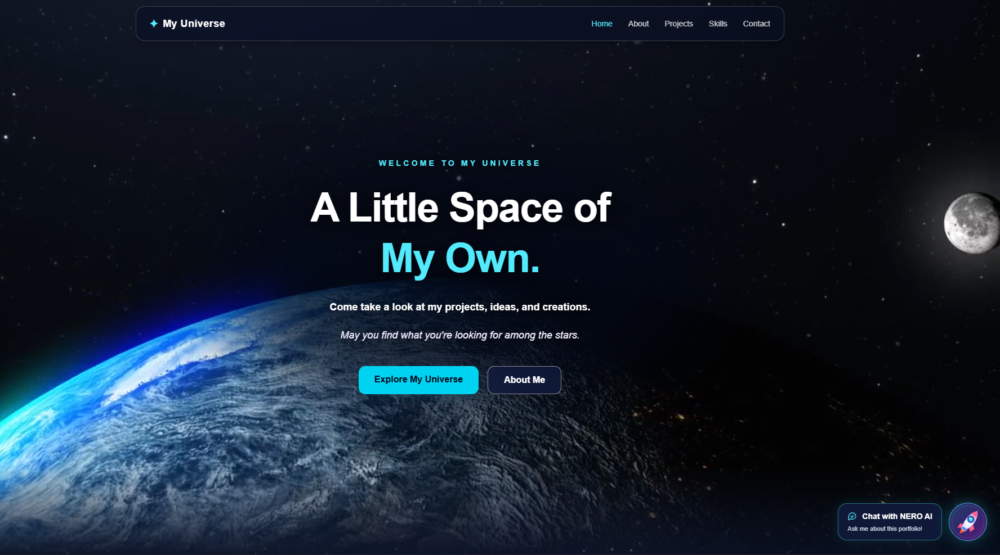
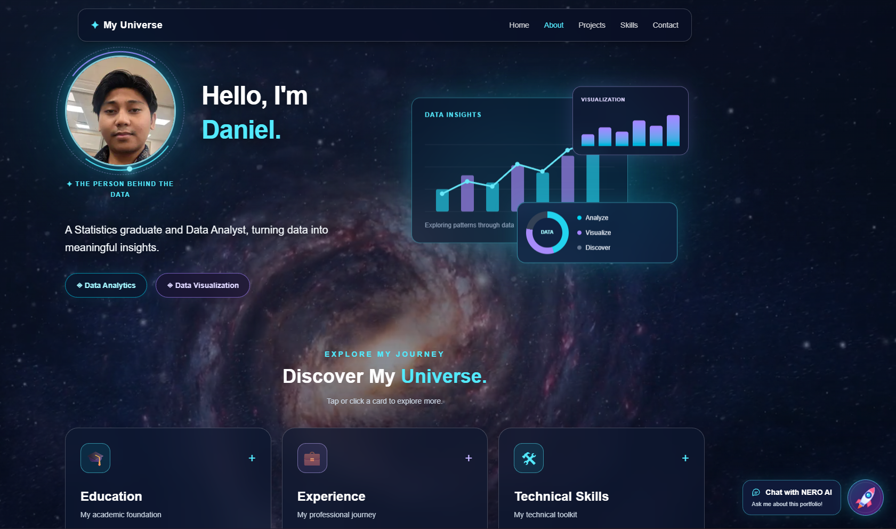
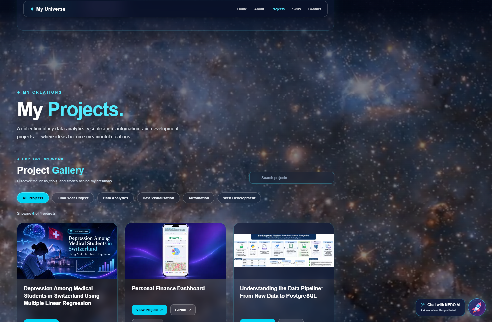

# 🌌 My Universe Portfolio

### An AI-Powered Personal Portfolio Website

**A personal space where data analytics, technology, creativity, and continuous learning come together.**

[**Live Website**](https://my-universe-portfolio.vercel.app) | [**GitHub Repository**](https://github.com/NeroReiki/my-universe-portfolio)

---

## 🌠 1. About the Project

**My Universe Portfolio** is a responsive personal website developed using **Next.js, React, TypeScript, and Tailwind CSS**.

The website showcases my educational background, professional experience, technical skills, and personal projects in an interactive, galaxy-inspired environment.

Beyond presenting my work, this portfolio also serves as a hands-on web development project through which I explore modern frontend technologies, responsive design, API integration, and AI-powered applications.

One of its main features is **NERO AI**, a Gemini-powered portfolio assistant that helps visitors learn more about my background, projects, and technical experience.

## 🖥️ 2. Website Preview

### Home — Welcome to My Universe



A space-inspired homepage featuring an animated galaxy background, interactive navigation, and access to NERO AI.

### About — The Person Behind the Data



A section highlighting my education, experience, and professional journey.

### Projects — Explore My Work



An interactive project gallery featuring category filters, keyword search, project previews, and dedicated detail pages.

## ✨ 3. Key Features

### Galaxy-Inspired Interface

- Animated galaxy video backgrounds across website sections.
- Smooth visual transitions and translucent interface elements.
- Responsive layouts for desktop and mobile devices.
- Interactive project cards with hover effects.
- Single-page scrolling between the main sections.

### Interactive Project Gallery

- Dynamic project cards powered by structured TypeScript data.
- Category-based project filtering.
- Keyword search.
- Individual project detail pages.
- Links to GitHub repositories and live demonstrations where available.

### NERO AI — Portfolio Assistant

- Gemini-powered conversational assistant.
- Answers questions about my education, skills, and projects.
- Uses curated portfolio-specific knowledge.
- Communicates through a Next.js server-side API endpoint.
- Uses environment variables to protect API credentials.

### Performance and Accessibility

- Optimized background videos for mobile devices.
- Viewport-aware video playback.
- Video pausing when sections are not visible.
- Reduced-motion preference support.
- Responsive navigation and layouts.

## 🤖 4. NERO AI — How It Works

NERO AI is an AI assistant integrated into the portfolio using the **Google Gemini API**.

Instead of being trained as a separate AI model, NERO AI uses curated information about my portfolio to provide context-specific answers to visitors.

### NERO AI Architecture

```text
           Website Visitor
                  |
                  v
             NERO AI Chat
                  |
                  v
       Next.js API Endpoint
         /api/chat
                  |
                  v
       Portfolio Knowledge
     portfolioKnowledge.ts
                  |
                  v
           Gemini API
                  |
                  v
         Generated Response
                  |
                  v
             NERO AI Chat
```

### How the Integration Works

1. A visitor submits a question through the NERO AI chat interface.
2. The frontend sends the question to the Next.js API endpoint.
3. The server provides relevant portfolio knowledge as context.
4. The Gemini model generates a response.
5. The response is displayed in the chat interface.

The portfolio knowledge includes information about my projects, technical skills, education, and website development.

**Security:** Gemini API credentials are configured through server-side environment variables and are not intentionally exposed in the frontend application.

## 📂 5. Featured Projects

The portfolio currently showcases four projects.

### Project 1 — Final Year Project

**Depression Among Medical Students in Switzerland Using Multiple Linear Regression**

An academic statistical research project investigating factors associated with depression among medical students in Switzerland.

**Technologies:** SPSS, SAS, Power BI, Statistical Analysis

[View Project](https://my-universe-portfolio.vercel.app/projects/depression-medical-students-switzerland)

### Project 2 — Personal Finance Dashboard & Expense Tracker

A personal finance tracking application developed to monitor income, expenses, account balances, commitments, and spending patterns.

Its features include interactive financial charts, transaction filtering, and GPS spending visualization.

**Technologies:** Google Apps Script, Google Sheets, HTML, CSS, JavaScript, Chart.js, Leaflet

[View Project](https://my-universe-portfolio.vercel.app/projects/personal-finance-dashboard)

### Project 3 — Understanding the Data Pipeline: From Raw Data to PostgreSQL

A hands-on learning project demonstrating how synthetic banking data moves through extraction, cleaning, transformation, validation, and preparation for relational database storage.

The tested Python ETL process transformed:

| Dataset | Raw Records | Cleaned Records |
|---|---:|---:|
| Customers | 105 | 100 |
| Accounts | 150 | 113 |
| Transactions | 1,000 | 591 |
| **Total** | **1,255** | **804** |

The project includes PostgreSQL schema definitions and SQL analysis queries. Database loading is optional and has not been retested in the public learning version.

**Technologies:** Python, Pandas, SQLAlchemy, PostgreSQL, SQL, JSON

[View Project](https://my-universe-portfolio.vercel.app/projects/learning-banking-data-pipeline) | [GitHub](https://github.com/NeroReiki/learning-banking-data-pipeline)

### Project 4 — My Universe Portfolio

**An AI-Powered Personal Website**

The website documented in this repository.

A personal web development project focused on responsive frontend development, reusable React components, interactive interfaces, Gemini API integration, and deployment.

**Technologies:** Next.js, React, TypeScript, Tailwind CSS, Gemini API, GitHub, Vercel

[View Project](https://my-universe-portfolio.vercel.app/projects/my-universe-portfolio)

## 🛠️ 6. Technology Stack

| Category | Technologies |
|---|---|
| Frontend Framework | Next.js, React |
| Programming Language | TypeScript |
| Styling | Tailwind CSS |
| AI Integration | Google Gemini API |
| Backend/API | Next.js API Routes |
| Development Environment | Visual Studio Code |
| Version Control | Git, GitHub |
| Hosting & Deployment | Vercel |

## 🗂️ 7. Project Structure

The main application is organized using the Next.js App Router.

```text
frontend/
|
├── public/
│   ├── videos/
│   ├── images/
│   │   └── projects/
│   └── documents/
│
├── src/
│   ├── app/
│   │   ├── page.tsx
│   │   ├── layout.tsx
│   │   ├── projects/
│   │   │   └── [slug]/
│   │   └── api/
│   │       └── chat/
│   │           └── route.ts
│   │
│   ├── components/
│   │   ├── layout/
│   │   ├── about/
│   │   ├── projects/
│   │   ├── skills/
│   │   └── contact/
│   │
│   └── data/
│       ├── projectTypes.ts
│       ├── projects.ts
│       ├── portfolioKnowledge.ts
│       └── projects/
│           ├── finalYearProject.ts
│           ├── financeDashboard.ts
│           ├── bankingDataPipeline.ts
│           └── myUniversePortfolio.ts
│
├── package.json
├── next.config.ts
└── README.md
```

**Key components:**

- `src/app/page.tsx` — Main portfolio page.
- `src/components/` — Reusable website components.
- `src/data/projects.ts` — Project registry.
- `src/data/projects/` — Individual project information.
- `src/data/portfolioKnowledge.ts` — Context used by NERO AI.
- `src/app/api/chat/route.ts` — Server-side chatbot endpoint.

## 🚀 8. Running the Project Locally

### Prerequisites

- Node.js
- npm
- Visual Studio Code or another code editor

### Clone the Repository

```bash
git clone https://github.com/NeroReiki/my-universe-portfolio.git
cd my-universe-portfolio
```

### Install Dependencies

```bash
npm install
```

### Configure Environment Variables

The NERO AI integration requires a Gemini API credential.

Create a `.env.local` file and configure the environment variable expected by `src/app/api/chat/route.ts`.

Consult that file for the exact variable name.

**Never commit `.env.local` or share API credentials publicly.**

The website's other sections can be explored independently of the chatbot integration.

### Start the Development Server

```bash
npm run dev
```

Open:

http://localhost:3000

On Windows PowerShell, `npm.cmd run dev` can be used if the PowerShell execution policy prevents `npm` from running.

### Build for Production

```bash
npm run build
```

## ☁️ 9. Deployment

The portfolio is version-controlled through Git and GitHub and hosted on **Vercel**.

The deployment workflow is:

```text
Local Development
        |
        v
     Git Commit
        |
        v
    GitHub Push
        |
        v
  Vercel Deployment
        |
        v
   Live Portfolio
```

Environment variables for NERO AI are configured separately in the deployment environment.

**Live website:** https://my-universe-portfolio.vercel.app

## 📚 10. What I Learned

Building this portfolio provided practical experience in:

- Developing a website with Next.js and TypeScript.
- Creating reusable React components.
- Designing responsive user interfaces.
- Using Tailwind CSS for consistent styling.
- Implementing dynamic routes and project galleries.
- Optimizing animated backgrounds for performance.
- Integrating a conversational AI service through a server-side API.
- Managing sensitive configuration with environment variables.
- Using Git and GitHub for version control.
- Deploying and maintaining a website through Vercel.

The portfolio also represents my learning process as I expand my skills beyond statistics and data analytics into web development and AI integration.

## 🔭 11. Future Improvements

The project will continue evolving as I learn and develop new skills.

Potential improvements include:

- Adding more data analytics and development projects.
- Expanding project case studies and documentation.
- Improving NERO AI's portfolio knowledge and responses.
- Enhancing website accessibility.
- Further optimizing performance across different devices.
- Introducing additional interactive features.

---

## 🌌 Final Note

**My Universe is more than a collection of projects.**

It is a space where I document my learning journey, explore new technologies, and transform ideas into practical work.

*May you find what you are looking for among the stars.*

**Built with Next.js, TypeScript, Tailwind CSS, and curiosity.**

[Live Portfolio](https://my-universe-portfolio.vercel.app) | [GitHub](https://github.com/NeroReiki/my-universe-portfolio)